# lilalt journal

## nov 4 · ~5.5 hrs

schematic from this morning

added a status led on the spare pin. backwards

footprints. no idea what any of this is

typed into the wrong box

coin cell holder

3 headers that look identical. picked 1

picked the sideways switch by accident

header fixed. switch still wrong

led the right way round now

every part has a footprint

0 errors

added a 10u cap. typed 10n. 1000x too small

fixed

every part on top of each other

spread out. there is no auto place button

chip still in the corner

chip in the middle

tiny parts in the wrong spot

good enough

found edge.cuts

board outline. tight

buzzer hanging off the edge

fixed

menus are at the top of the screen on mac. took a while

ground pour. it was on the front, not the back

autorouted it with freerouting, asked claude to debug so it doesnt explode then moved c1/c2 next to the chip, mounting holes, pin labels, my n@ + made with <3. bom.csv all claude tho (if this is a issue tell me and ill redo bom.csv myself

## nov 6 · ~2.5 hrs

reviewer said the ch32v003 isnt on mouser or digikey, so i deleted everything and started over

attiny412 instead. same 8 pins, programs over 1 wire (updi)

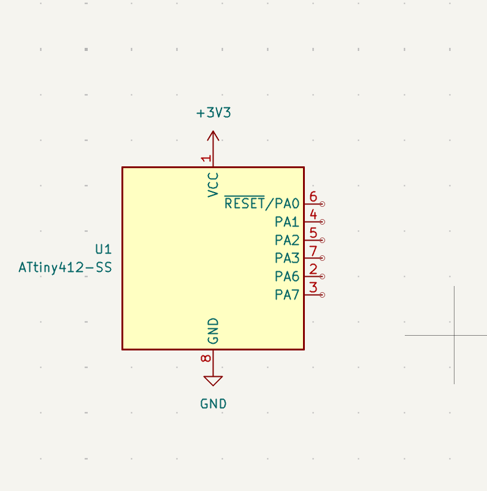

sensor header + caps. swapped sda and scl

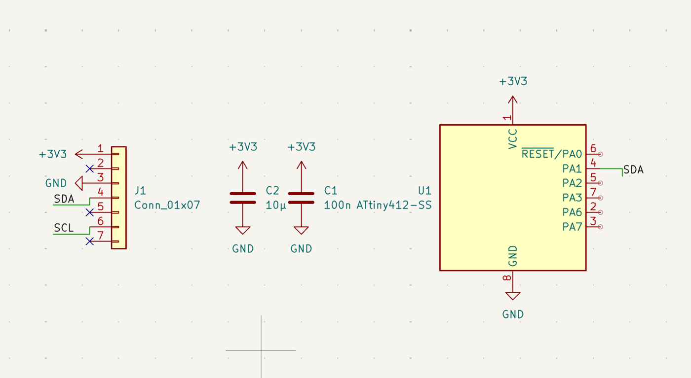

fixed that then wired sda into the programming pin

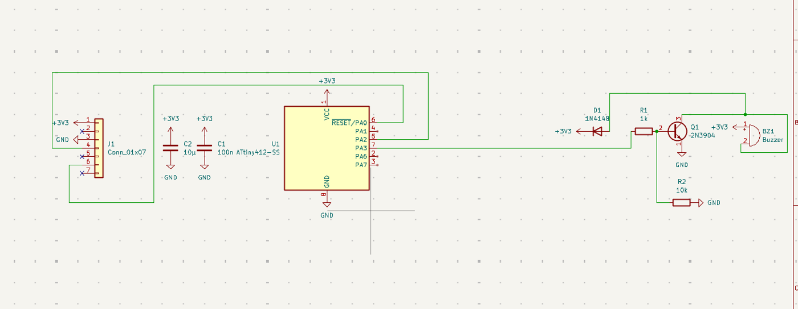

actually fixed

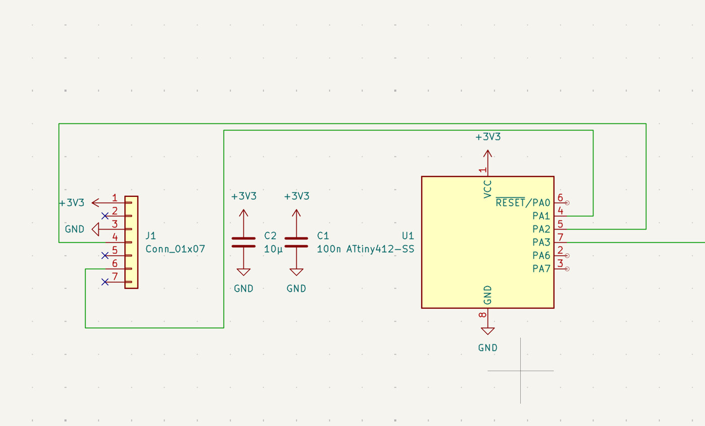

buzzer. 10k so it doesnt chirp while the chip boots, 1n4148 so the coil doesnt fry the transistor when it switches off

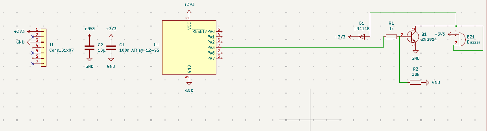

led

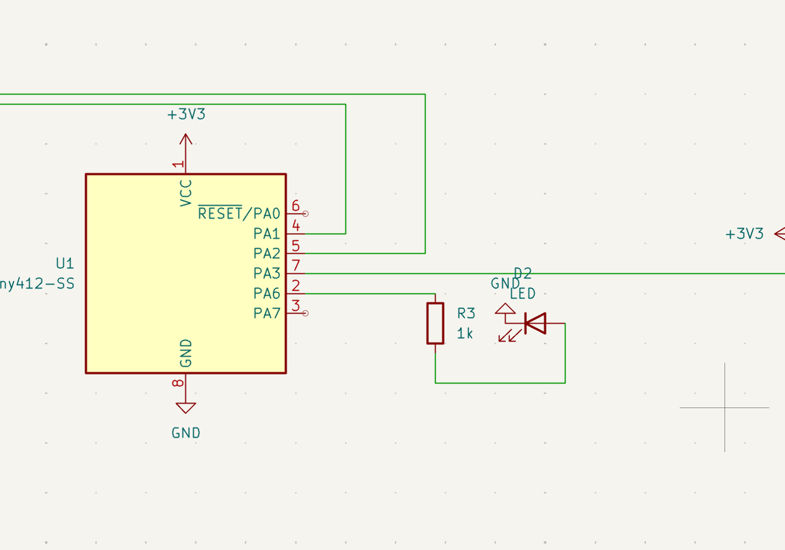

battery, switch, power flags. 0 errors

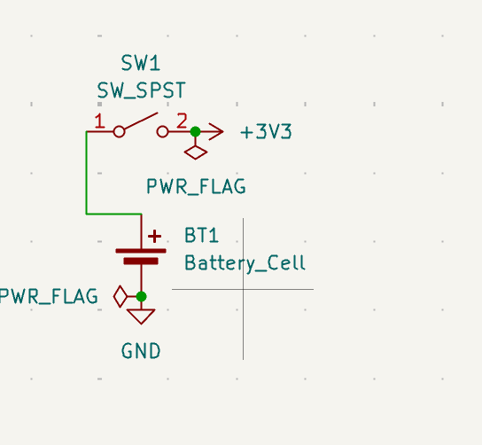

whole schematic

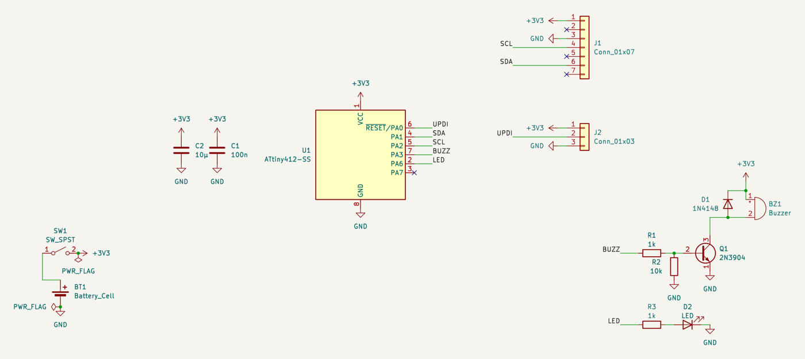

everything through hole except the chip so its easy to solder. picked a fan header for j2 by accident

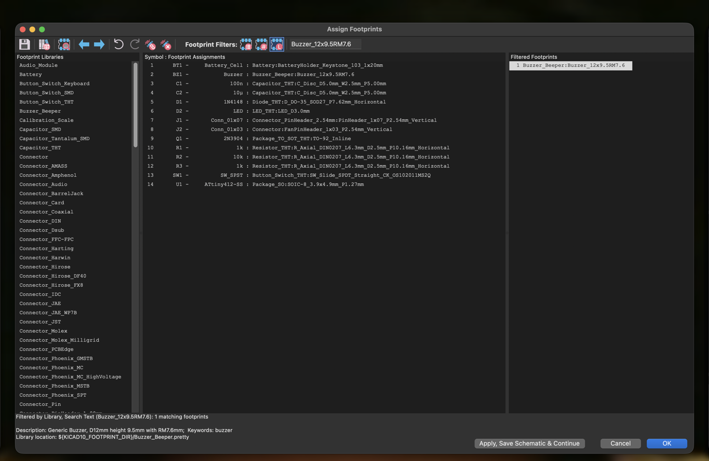

parts dumped on the board

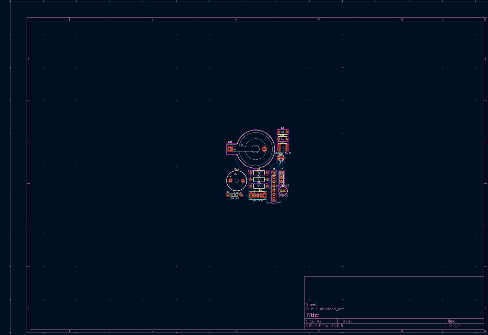

first layout. 42mm wide, wont fit in a rocket tube and the sensor would sit on the buzzer

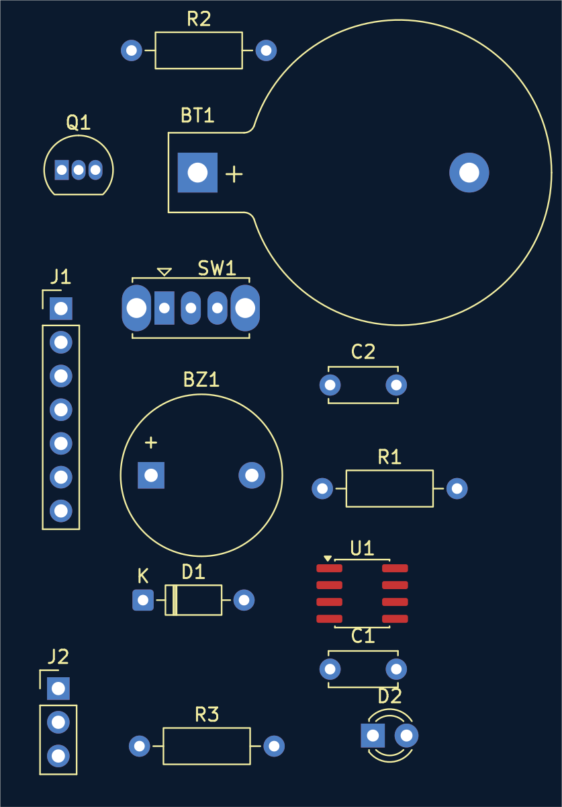

30mm wide now. sensor plugs into j1 and hangs off the end so nothing hits it

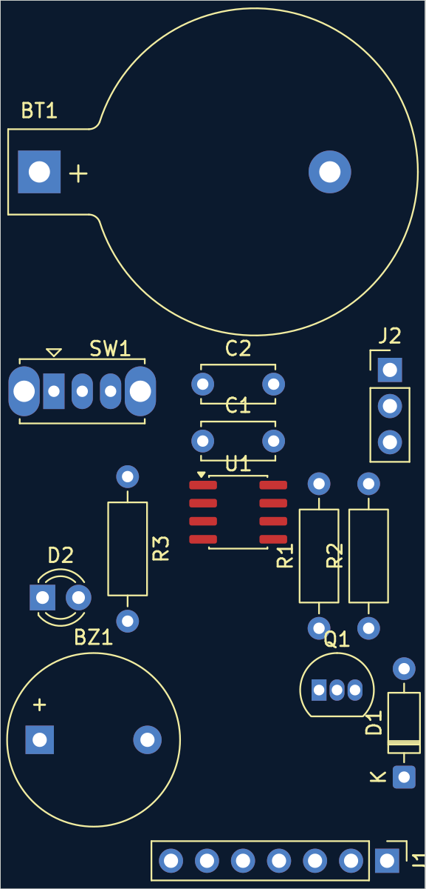

routed. ground pour on both sides, 0 drc errors

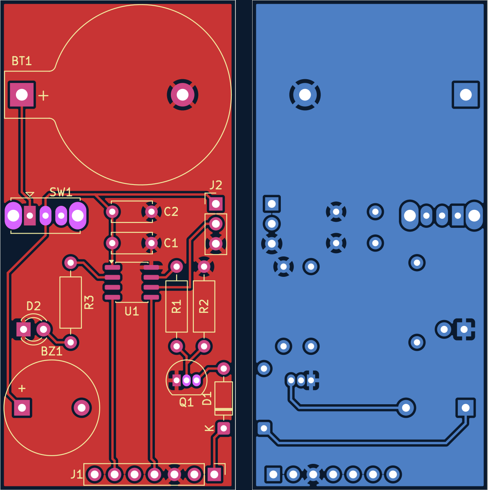

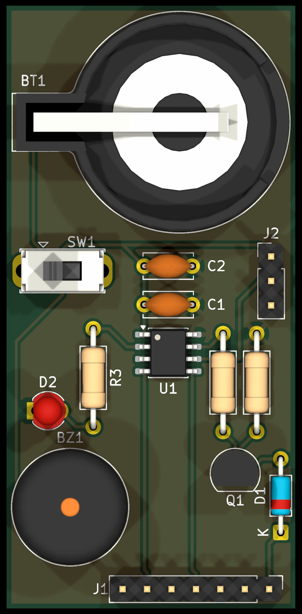

bom.csv exported from kicad with digikey part numbers for everything

## nov 8 · ~0.5 hrs

reviewer said a cr2032 can only give ~3mA and the buzzer wants ~35mA. it would brown out the chip mid beep

swapped it for a passive piezo (tdk ps1240p02bt) wired straight across pa3 and pa7. the pins take turns so it gets a 6v swing off a 3v cell. no transistor, no diode, no base resistors

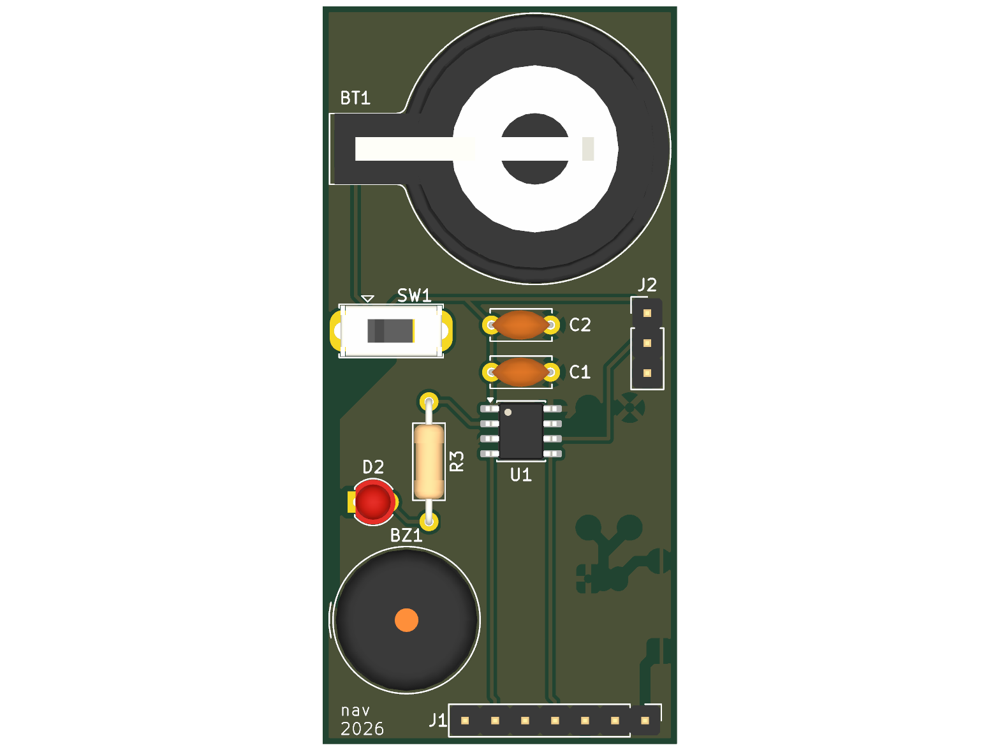

deleted q1 d1 r1 r2, piezo goes where the old buzzer was, rerouted by hand. pa3 sneaks under the sda pin to get across. 3v3 to the sensor used to run through the old diode so it got a new trace down the edge. drc clean

bom re-exported from kicad
